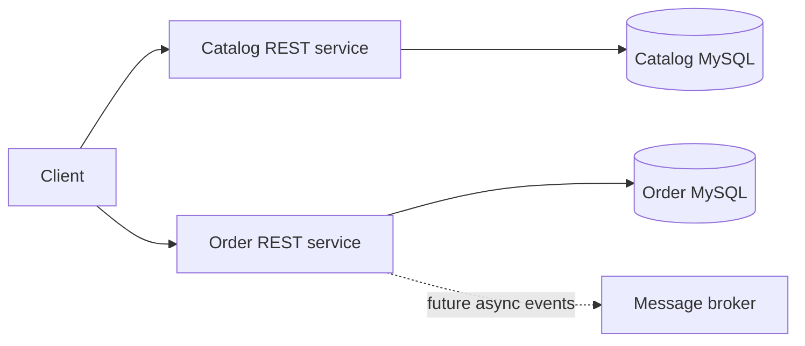

# E-commerce Microservices

A small multi-service portfolio demonstrating independent catalog and order services, each with its own Spring Boot app and MySQL database. It intentionally keeps service data isolated.

## Run

Requires Docker Compose. `docker compose up --build`. Catalog: `http://localhost:8082`; Orders: `http://localhost:8084`.

## APIs

- `GET /api/v1/products?page=0&size=20`; `GET /api/v1/products/{id}`; `POST /api/v1/products`
- `GET /api/v1/orders?page=0&size=20`; `GET /api/v1/orders/{id}`; `POST /api/v1/orders`

Example create product: `curl -i localhost:8082/api/v1/products -H 'Content-Type: application/json' -d '{"name":"Desk lamp","description":"LED lamp","price":39.95,"sku":"LAMP-001"}'`

Example order: `curl -i localhost:8084/api/v1/orders -H 'Content-Type: application/json' -d '{"productId":1,"quantity":2,"customerEmail":"buyer@example.test"}'`

## Assumptions and production follow-up

Java 17, Spring Boot 3.3, MySQL 8.4. The order service stores a product ID but does not yet call catalog or reserve inventory; this avoids implying a distributed transaction is already solved. Add catalog lookup, outbox/event delivery, idempotency, inventory reservation, OAuth2/JWT resource-server configuration, migrations, observability, and Testcontainers before production. Local credentials are demo-only. Hibernate schema update is local starter behavior. No deployment or test execution is claimed. Each service includes a MockMvc validation test; test execution has not been verified here.
